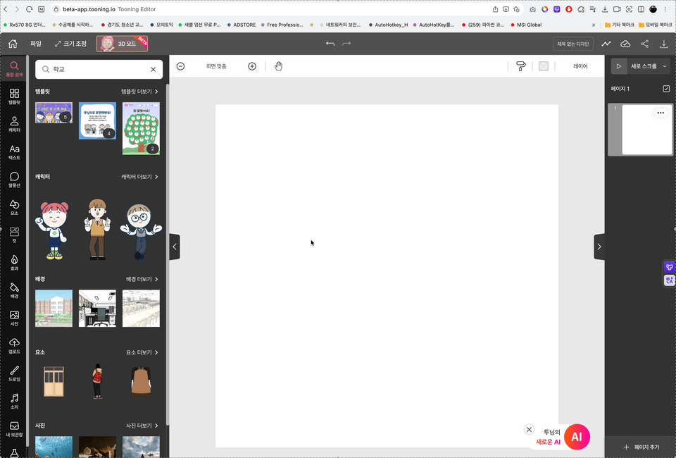
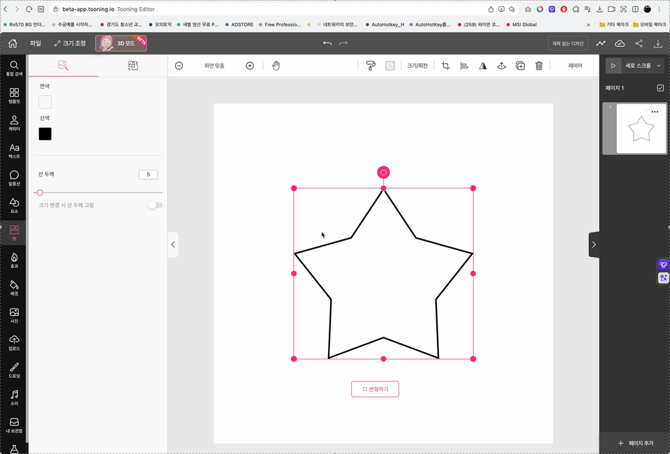
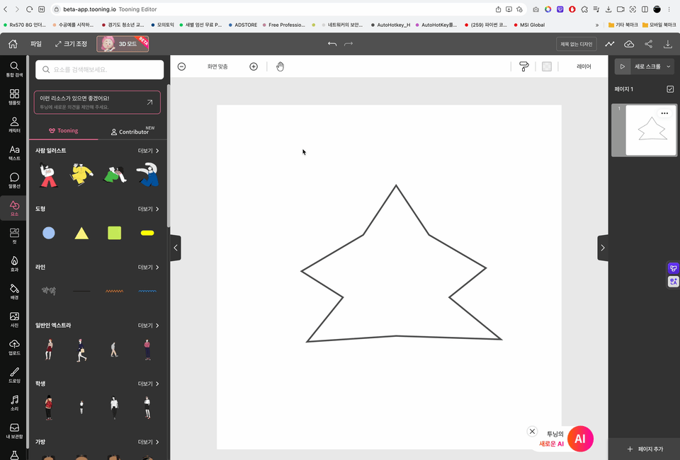
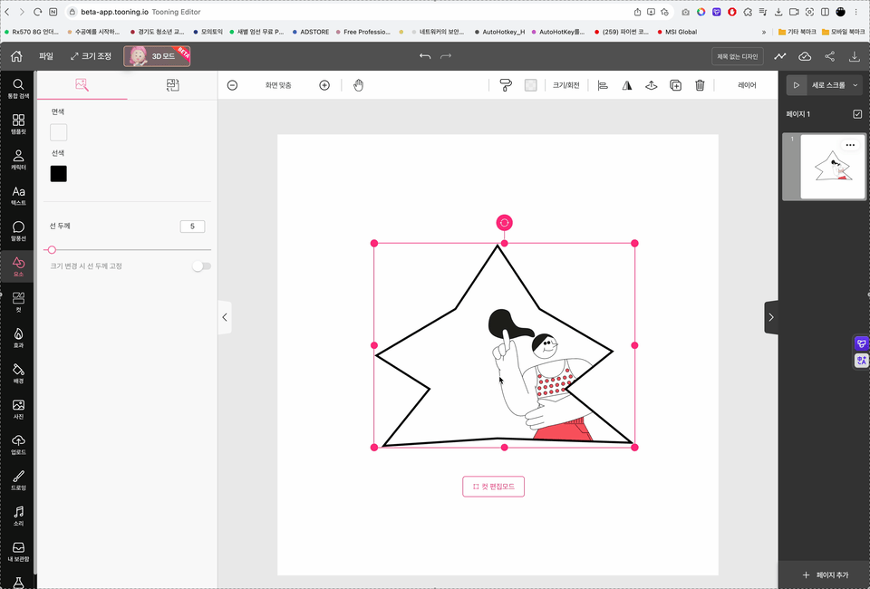
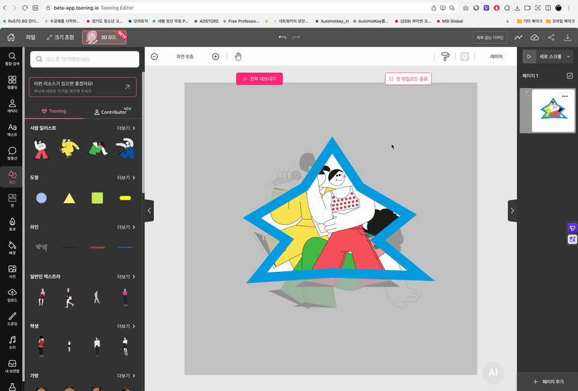
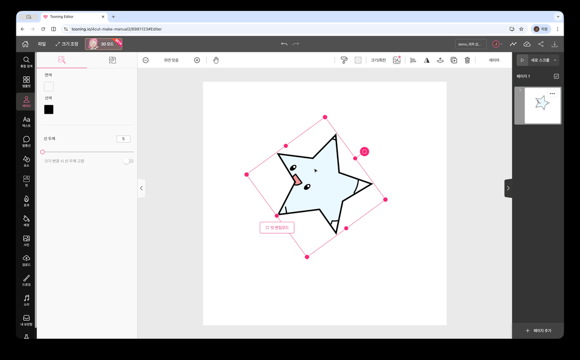
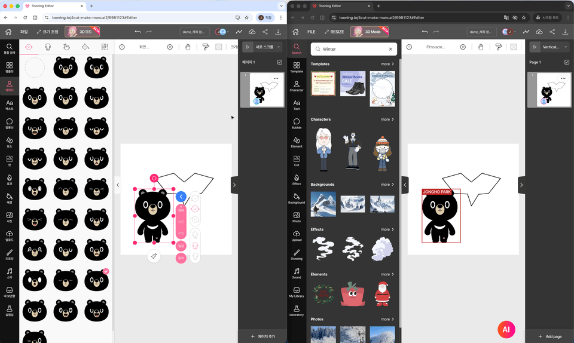

# 컷(Cut) 기능?

투닝 에디터의 다양한 요소(캐릭터, 배경 등)를 테두리 모양을 자유롭게 조절가능한 컷의 가시영역에 따라 보이게하는,  `그림 액자`와 같은 기능입니다.

:::note[최대한 간단하게 동작원리를 요약하면]
[Fabric의 Cache용 캔버스](https://fabricjs.com/docs/fabric-object-caching/)와 [Web Canvas의 `globalCompositeOperation` 속성](https://developer.mozilla.org/ko/docs/Web/API/CanvasRenderingContext2D/globalCompositeOperation)을 활용해서 에디터 캔버스 내부에 형태가 다양한 다각형의 작은 캔버스들을 추가하는 기능입니다.
:::

# 사용 방법

## 캔버스에 컷 요소 추가하기

좌측 사이드 메뉴에서 `컷` 메뉴를 클릭해서, 마음에 드는 모양의 컷을 클릭해서 캔버스에 추가합니다.

* 소스코드는 `create-cut.component` 참고
  

## 컷 테두리 변형하기

추가된 컷을 클릭하면 보이는 `변형하기` 버튼을 클릭해 테두리 모양을 원하는 대로 변형합니다.
**버튼을 다시 누르면, 원래의 크기/회전 조절 기능으로 복원됩니다.**

* 소스코드는 `masked-cut-buttons.component` 의 `editPolygon()` 함수 참고

## 컷 배경/테두리 색상, 테두리 두께 조절 기능

컷 클릭 시 보이는 사이드 메뉴에서 조절 가능합니다.

* 요소 세부설정 탭과 동일한 컴포넌트로 관리됨

## 컷 안에 투닝 에디터 요소 넣기

투닝의 요소 하나 또는 여러개를 컷 위로 드래그해서 컷안에 집어넣습니다.
**컷 안에 요소를 집어넣은 후로는 컷 테두리를 변형할 수 없습니다.**

* 컷 위에 마우스를 올렸을 때 보여지는 Affordance 효과는 `event.object.service` 내 `ObjectMoving()` 참고
* 컷 안에 요소를 집어넣는 기능은 `mouse-up-task` 의 `onMouseUpClippingTask()` 참고

## 컷 편집모드 진입/종료

컷 안에 들어간 요소의 배치가 맘에들지 않는다면, 컷을 더블클릭 또는 `컷 편집모드` 버튼을 클릭해서 편집모드에 진입합니다.
컷 테두리 밖을 더블클릭 또는 우상단에 보이는 `컷 편집모드 종료` 버튼을 클릭해서 현재까지의 변경점을 저장한채로 편집모드에서 나갈 수 있습니다.
추가로 편집모드 안에서는 되돌리기/재실행 (Undo/Redo) 기능이 정지됩니다.

* 컷 편집모드 진입 시 동작은 `masked-cut.service` 내 `editMaskedCut()`참고

## 컷 편집모드) 요소 바로 추가하기

컷 편집모드 상태에서 좌측 사이드 메뉴에서 원하는 요소를 바로 추가할 수 있습니다.

* 각 요소 추가 시, 컷 내부에서 추가된 요소는 fabric 속성값에 **`assetOfMaskedCut`** 값을 추가 후 true로 설정함

## 컷 편집모드) 컷 밖으로 내보내기

특정 또는 모든 요소를 컷 밖으로 내보낼 수 있습니다.
내보낸 요소는 컷 편집모드를 종료하고, 컷 외부로 이동한 것을 확인할 수 있습니다.

* 해당 기능은 `cut-edit-button.component` 내 `popAllAssetFromMaskedCut()` 참고

## 실행한 작업 취소/되돌리기

* 컷 편집모드 상태일 때는 제외하고, 컷 요소도 다른 요소들과 동일하게 되돌리기/재실행 (Undo/Redo)를 지원합니다.
  

## 협업모드에서도 사용가능

* 추후에 공개될 에디터 협업환경에서도 문제없이 동작하도록 수정하였습니다.
  
